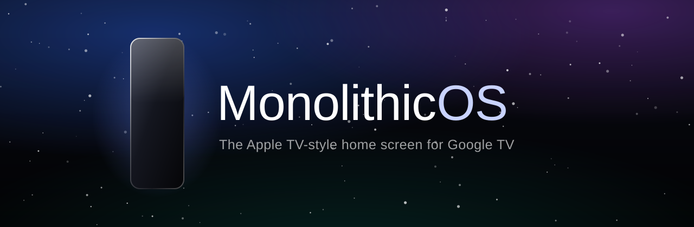
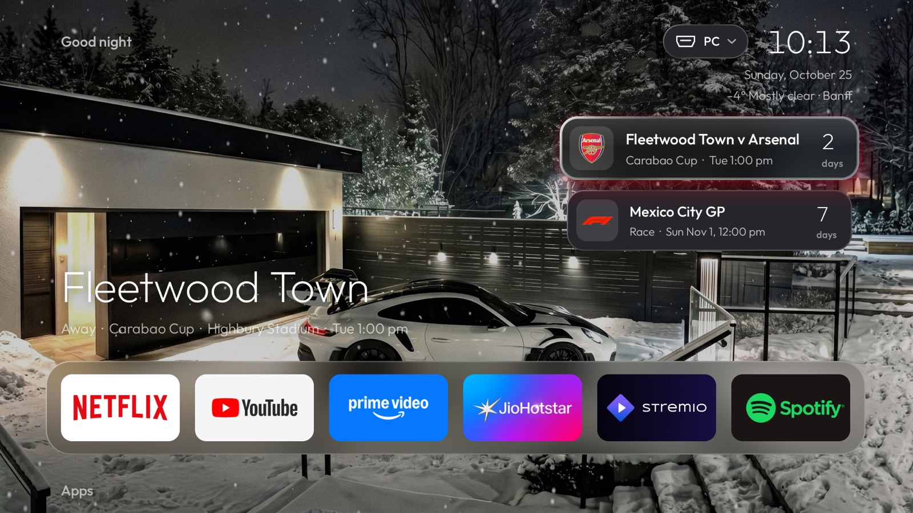
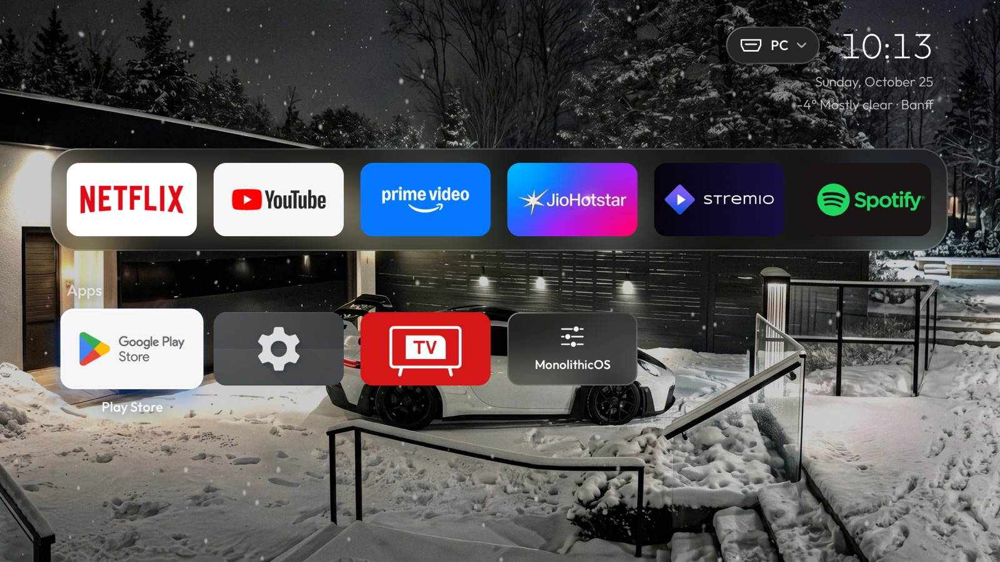

<p align="center">
  
</p>

<p align="center">
  <a href="https://github.com/ManjotSarna/MonolithicOS/releases/latest"></a>
  <a href="https://github.com/ManjotSarna/MonolithicOS/releases"></a>
  
  
  <a href="LICENSE"></a>
</p>

<p align="center">
  <b>Your Google TV, without the ads, the clutter and the lag.</b><br>
  Liquid glass, live sports cards, a live snow wallpaper and a phone remote.<br>
  One double-click to install. One to undo.
</p>

<p align="center">
  
</p>

---

## Why MonolithicOS

**Fast as hell.** A 550 KB home screen that uses about 31 MB of memory and redraws only what moves: with the
snow switched off it draws nothing at all while you're not touching it (the snow itself costs about a quarter of
one CPU core, at 30 smooth, motion-blurred frames a second). Measured on a TCL QM851G: 0.2% of frames dropped
while flying around the dock, no content rows loading in the background, and it's compiled ahead of time during
install so it's quick from the very first press. The optional debloat switches off around two dozen ad, promo
and telemetry services on top.

**No ads. No clutter. No tracking.** No sponsored rows, no autoplaying trailers, no "Top picks for you".
Your apps, a clock and a beautiful wallpaper. MonolithicOS has no account, no analytics and no servers.

**Liquid Glass design.** tvOS 26-style frosted glass that really blurs the wallpaper behind it, with rims lit
from the top left. Focused apps tilt toward the way you moved, lift, glow in their own colour and catch a
gloss sweep. Opening an app zooms its card to fill the screen. Push past the end of a row and it bumps, like
real glass. The dock sits low so the wallpaper owns the screen.

**A live wallpaper that ships with it.** *GT3 RS Snow*: a night-time GT3 RS in a snowed-in driveway, with real
falling snow drawn on top in three depths, swaying and motion-blurred. Add your own photos from your phone in
one tap, and turn the snow on for any of them.

**Next Up cards.** Pick **F1** and up to three teams, and a glass card under the clock shows the next race or
game with a countdown, the **live score and minute** while it's on, and the result afterwards. Press OK for the
whole weekend or fixture list, recent results and the league table. Football (Premier League, LaLiga, Serie A,
Bundesliga, Ligue 1, MLS and more), **NFL, NBA, WNBA, NHL and MLB**.

**A real phone remote.** Open the TV's address on your phone: a glass touchpad, back, home, play/pause,
volume, and **typing straight into the TV's search boxes**. Launch apps, switch inputs, change wallpapers and
every setting. On Android, the **MonolithicOS app** runs it full screen and finds your TV by itself.

**Everything else you'd expect, done properly.**
- **MonolithicOS Settings** right on the TV: ad blocking for the whole TV (AdGuard DNS), animation speed,
  wallpaper dim, falling snow, night mode, 12/24-hour clock, cards, screensaver.
- **Inputs, tucked away:** a glass pill by the clock names what's plugged in (rename "HDMI 1" to "PC" or
  "PS5") and drops down the list.
- **Now Playing:** when music plays, a card with the album art; OK plays and pauses.
- **Weather** for your city, **night mode** that dims and warms everything after 10 pm, and **MonolithicOS
  Ambient**, a screensaver with a slow drifting wallpaper, a big clock and the snow.

**Safe and reversible.** No root, no hacks: MonolithicOS is a normal app made the Home screen over ADB, the
same way developers do. Nothing is deleted from the system. The uninstaller puts your TV back exactly as Google
shipped it in about 10 seconds. If a TV firmware update switches things back, MonolithicOS notices and tells you.

**Open source.** MIT licensed. Read every line, build it yourself, make it yours.

## Screenshots

<table>
  <tr>
    <td width="50%"><br><sub><b>Next Up cards</b>: the next game, live scores, results</sub></td>
    <td width="50%"><br><sub>OK on a card: fixtures, results, the league table</sub></td>
  </tr>
  <tr>
    <td><br><sub><b>F1</b>: every session in your time, the last podium, standings</sub></td>
    <td><br><sub><b>Inputs</b>: named, tucked into a pill by the clock</sub></td>
  </tr>
  <tr>
    <td><br><sub>Down from the dock: the rest of your apps</sub></td>
    <td><br><sub><b>MonolithicOS Settings</b> on the TV</sub></td>
  </tr>
</table>

<p align="center">
  
  
  
  
</p>
<p align="center"><sub>The phone remote: touchpad and typing, apps and inputs, wallpapers and settings, picking your teams.</sub></p>

## Install in 3 steps

You need the TV and a Windows PC or Mac on the same Wi-Fi. Takes about two minutes.

**1. Turn on USB debugging on the TV** (one time)
- Settings > System > About > scroll to **Android TV OS build** and press OK on it **7 times** ("You are now a developer").
- Back to Settings > System > **Developer options** > turn on **USB debugging**.
- Settings > Network & Internet > your Wi-Fi: note the TV's **IP address** (like `192.168.1.20`).

**2. [Download MonolithicOS.zip](https://github.com/ManjotSarna/MonolithicOS/releases/latest/download/MonolithicOS.zip)** and unzip it.

**3. Double-click the installer**
- **Windows:** `Install MonolithicOS (Windows).bat`
  <sub>(If Windows says it protected your PC: More info > Run anyway.)</sub>
- **Mac:** `Install MonolithicOS (Mac).command`
  <sub>(The first time: right-click it > Open > Open, because it isn't from the App Store.)</sub>
- **Linux:** `bash files/install.sh install`

Type the TV's IP, press **Allow** on the TV when it asks, and answer one question: *Debloat & tune too?*
(recommended). About 20 seconds later the Home button opens MonolithicOS. The installer fetches Google's
official ADB tools by itself if your computer doesn't have them.

> **Debloat & tune** switches off TCL and Google ad, promo and telemetry services, removes preinstalled freebie
> apps (Tubi, Pluto TV, Xumo, Haystack and co; **Netflix, YouTube, Prime Video, Disney+ and Spotify are never
> touched**), turns on AdGuard ad blocking and makes animations snappier. Accessibility features and Google
> Assistant stay. The uninstaller undoes all of it.

### The phone remote

On your phone (same Wi-Fi) open **`http://<tv-ip>:8899`** and type the PIN from MonolithicOS Settings > Phone
remote. **Android:** tap **Get** at the top for the full-screen MonolithicOS app, or
[download MonolithicOS-Remote.apk](https://github.com/ManjotSarna/MonolithicOS/releases/latest/download/MonolithicOS-Remote.apk)
on the phone. **iPhone:** Safari > Share > Add to Home Screen.

Then make it yours in the **Look** tab: your name for the greeting, your city for the weather, your wallpaper,
and **+ F1 / + Team** for your cards.

## Using it

| On the remote | Does |
|---|---|
| **OK** | Opens the app (zooms in), plays/pauses Now Playing, opens a card |
| **Hold OK** or **Menu** | Move, add or remove dock apps, App info, MonolithicOS Settings |
| **Up** from the dock | Your cards, then the Inputs pill by the clock |
| **Down** from the dock | All your apps; MonolithicOS Settings is the last tile |
| **Back** / **Home** | Jumps to the first app in the dock |
| **Netflix / Prime / YouTube buttons** | Open those apps (in any app with MonolithicOS Settings > App buttons > Everywhere) |

## Uninstall

Double-click `Uninstall MonolithicOS (Windows).bat` or `Uninstall MonolithicOS (Mac).command`. About 10 seconds:
Google's Home screen, the freebie apps, normal animations and DNS come back, and MonolithicOS is removed.
No computer? On the TV: MonolithicOS Settings > **Restore Google TV Home** > Enable.

## FAQ

<details><summary><b>Which TVs does it work on?</b></summary>

Built and tested on a TCL QM851G (Google TV 14). It should work on any Google TV or Android TV running Android 9
or newer with Google's launcher: TCL, Hisense, Sony, Philips, Chromecast with Google TV and others. The installer
checks first and stops if your TV isn't supported. It doesn't work on Fire TV, Roku, Samsung (Tizen) or LG (webOS).
</details>

<details><summary><b>Is it safe? Does it root my TV or void the warranty?</b></summary>

No root. MonolithicOS is a regular app; the installer uses ADB (Google's developer bridge) to make it the Home
screen and to switch off, not delete, the apps you choose. Everything is reversible with the uninstaller, and a
factory reset always brings back stock.
</details>

<details><summary><b>What still works without Google TV's home screen?</b></summary>

All your apps, casting, the Play Store, settings and Google Assistant. Two things rely on Google's launcher: the
remote's YouTube button (MonolithicOS Settings > App buttons > Everywhere brings it back, but then holding volume
steps one notch at a time), and searching for movies and shows by voice.
</details>

<details><summary><b>What happens when the TV updates?</b></summary>

A firmware update can switch Google's launcher or the debloated apps back on. MonolithicOS checks after every
update and shows an amber banner if anything came back; run the installer again and it's sorted.
</details>

<details><summary><b>Does it send my data anywhere?</b></summary>

MonolithicOS has no account and no analytics. It only talks to: Open-Meteo for the weather, ipapi.co once on the
first run to guess your city, ESPN and Jolpica-F1 for your cards (only if you add any), and AdGuard DNS if ad
blocking is on. The phone remote stays on your home network, behind a PIN.
</details>

<details><summary><b>How do I update?</b></summary>

Download the newest release and run the installer again. Your settings, dock and cards stay.
</details>

## Build it yourself

You need JDK 17 and the Android SDK (platform 34, build-tools 34.0.0). No Gradle.

```bash
./tools/package.sh      # builds remote/ and launcher/, then dist/MonolithicOS.zip
```

`launcher/` is the TV app, `remote/` the phone app (the launcher carries it and serves it to phones),
`installer/` the installers. Builds are signed with a local development key unless `MONOLITHIC_KEYSTORE` and
`MONOLITHIC_KEYPASS` point at yours.

## Credits

Made by [Manjot Sarna](https://github.com/ManjotSarna), with Claude.
*GT3 RS Snow* wallpaper by Manjot Sarna. Font: [Outfit](https://fonts.google.com/specimen/Outfit) (SIL Open Font
License). Weather by [Open-Meteo](https://open-meteo.com), scores and fixtures from ESPN, F1 from
[Jolpica-F1](https://github.com/jolpica/jolpica-f1).

MonolithicOS isn't affiliated with or endorsed by Apple, Google, TCL, Porsche, Formula 1 or ESPN. Their names
and logos belong to them.
