
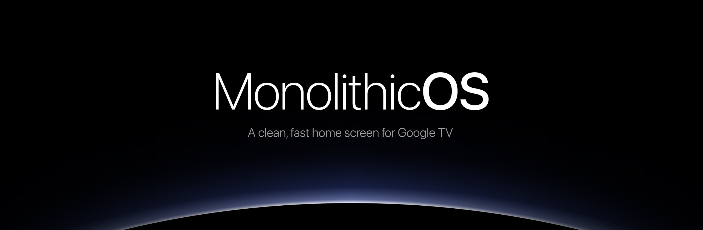

  
  
  
  

<h3 align="center">Google TV's home screen is a billboard. This swaps it for your apps and a clock. 
Double-click to install, double-click to undo. 0.6 MB.</h3>

  <a href="https://github.com/ManjotSarna/MonolithicOS/releases/latest/download/MonolithicOS.zip"><b>Download</b></a> ·
  <a href="#install">Install in 3 steps</a> ·
  <a href="#uninstall">Undo</a>

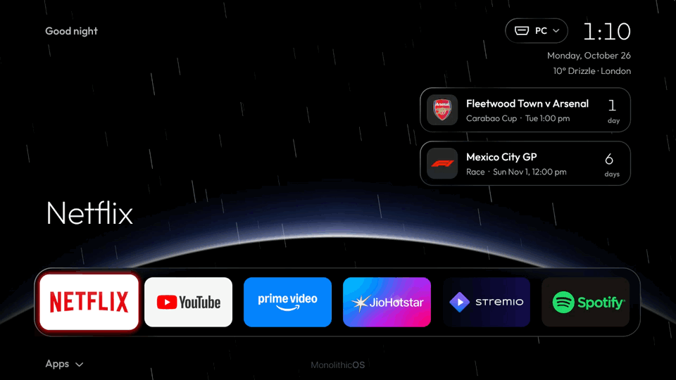

I got tired of the Google TV home screen. Ads in every row, stuff I'd never watch, and it felt slow on a TV that
cost way too much. So I made my own: your apps, a clock, nothing else, and it's quick. Works on any Google TV or
Android TV (TCL, Sony, Hisense, Philips, Chromecast with Google TV...).

## Google TV vs MonolithicOS

| | Google TV home | MonolithicOS |
|---|---|---|
| **Size** | 24.5 MB app, **~327 MB** with its data and cache | **0.6 MB** app, **~5 MB** all in |
| **Memory** | **~135 MB** across two processes | **~50 MB** |
| **Home screen** | Promoted shows, sponsored rows, autoplaying trailers | **Your apps.** That's it |
| **Ads** | Yes | **None** |
| **Tracking** | Uses what you watch for recommendations and ads | **None.** No account, no analytics |
| **Ad & tracker blocking** | Not built in | **The whole TV**, one switch (AdGuard DNS) |
| **While you watch** | Refreshing rows and recommendations | **0% CPU** |
| **Phone remote** | Needs Google's app and your Google account | **Any phone browser.** No account, stays on your Wi-Fi, PIN-locked |

Sizes and memory measured on my TCL QM851G (Google TV 14), October 2026.

**Is it an actual OS?** No, it's a home screen. Android, your apps and the Play Store stay exactly as they
are. But it doesn't just sit on top of Google's home screen: it switches it off completely, so Google's
launcher isn't running your TV in the background anymore.

## What it does

- **Fast.** The whole thing is about 600 KB and uses ~50 MB of RAM. 0% CPU while you're watching something:
  nothing runs in the background, the cards only update while you're on the home screen.
- **Looks like tvOS.** Apps tilt, lift and glow in their own colour when you land on them, then open out into
  the dark, lit in their colour. Frosted glass dock and cards, or Floating: everything sits right on the
  wallpaper and only what you're on gets the glass.
- **An intro worth pressing Home for.** The MonolithicOS name draws itself together out of black and Home rises
  in behind it, when the TV comes on and every time you press Home in an app.
- **No ads, no tracking.** No account either.
- **Cards for F1 and your teams.** Countdown to the next race or game, live score while it's on, results after.
  Football (Premier League, LaLiga, Serie A, Bundesliga, Ligue 1, MLS...), NFL, NBA, NHL, MLB.
- **Weather on your wallpaper.** Snowing outside, it snows on the home screen. Raining, it rains. The Horizon
  wallpaper goes dawn, day, dusk, night with the actual time.
- **Your apps, your way.** Hide any app, rename it, give it your own picture, or lock it behind a parental PIN.
  Make your own rows (Streaming, Sports, Kids) and folders, and a Recent row keeps your last few apps close.
- **Phone remote.** Touchpad, type into the TV's search boxes, open apps, switch inputs, change settings,
  sort out your apps, and back up every setting to one file for a new TV. Android app included.
- **Settings on the TV.** Ad blocking for the whole TV, dim the wallpaper or the app icons, night mode,
  animation speed, 30 fps mode if your TV's on the slow side, all of it. The screensaver is MonolithicOS's own:
  a big thin clock over your wallpaper.
- **Inputs in a dropdown** by the clock, the weather, and a Now Playing card that takes you straight back
  into what you paused.
- **4 OLED wallpapers** built in, the Aurora (soft lights in the colour of the app you're on), or send your own
  photos from your phone.
- **Task Manager.** CPU, memory, storage, temperature and every app running with its CPU and memory.
  Force stop one, or free up memory in one press. Only runs while it's open.
- **Optional debloat.** Turns off Google's ad services, TCL's junk and the preinstalled freebie apps (Tubi,
  Pluto and co).
- **Nothing permanent, and no way to get stuck.** No root. The uninstaller puts your TV back to stock in about
  10 seconds. A tiny safety app comes along: if MonolithicOS is ever removed while Google's home is off, it shows
  one button back to Google TV. And if MonolithicOS keeps crashing, it starts in a bare safe mode with the same
  way out.

  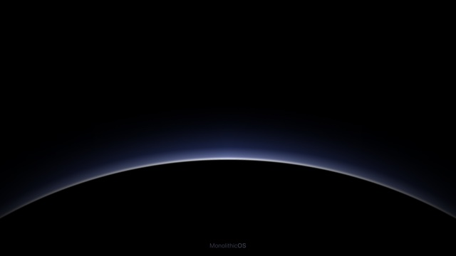
  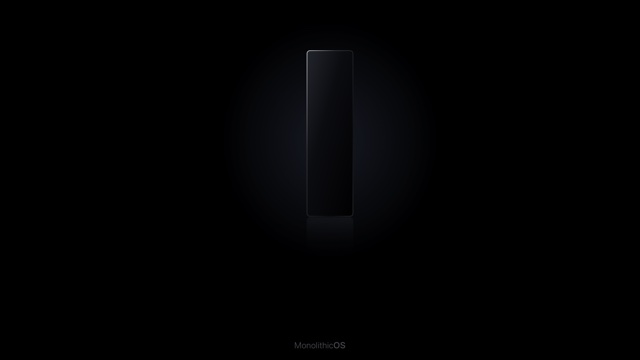
  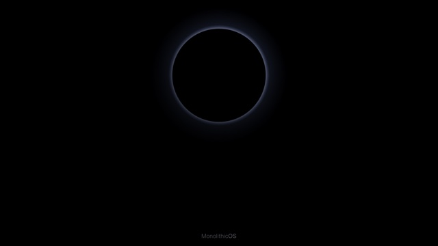
  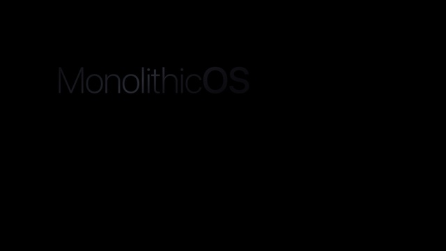

## Install

You need the TV and a PC or Mac on the same Wi-Fi.

1. **On the TV:** Settings > System > About, click **Android TV OS build** 7 times. Then Settings > System >
   Developer options > turn on **USB debugging**. Note the TV's IP (Settings > Network & Internet).
2. **Download [MonolithicOS.zip](https://github.com/ManjotSarna/MonolithicOS/releases/latest/download/MonolithicOS.zip)** and unzip it.
3. **Double-click** `Install MonolithicOS (Windows).bat` or `Install MonolithicOS (Mac).command`. Type the IP,
   hit **Allow** on the TV. Done in about 20 seconds.

Mac: right-click > Open the first time. Windows: if SmartScreen shows up, More info > Run anyway.
Linux: `bash files/install.sh install`. The installer grabs Google's ADB tools on its own if you don't have them.

**No computer?** Install `MonolithicOS.apk` with the free Downloader app (or Send Files to TV), turn on USB
debugging as in step 1, then open MonolithicOS from Google TV's home: TV Setup switches Google's home off,
debloats, and puts it all back, all from the TV.

**Phone remote:** open `http://<tv-ip>:8899` on your phone. The PIN is in MonolithicOS Settings (last tile under Apps).
On Android, tap **Get** up top for the app. That's also where you set your name, city, wallpaper and cards.

## Screenshots

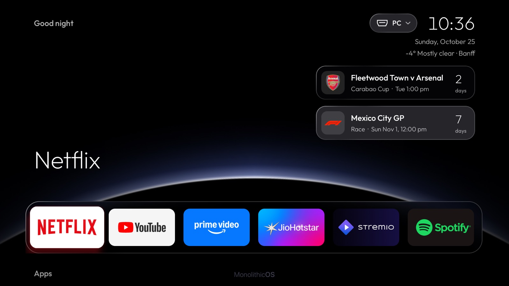

<table>
  <tr>
    <td width="50%">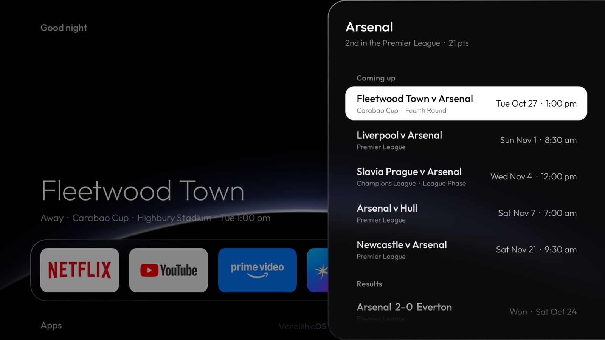</td>
    <td width="50%">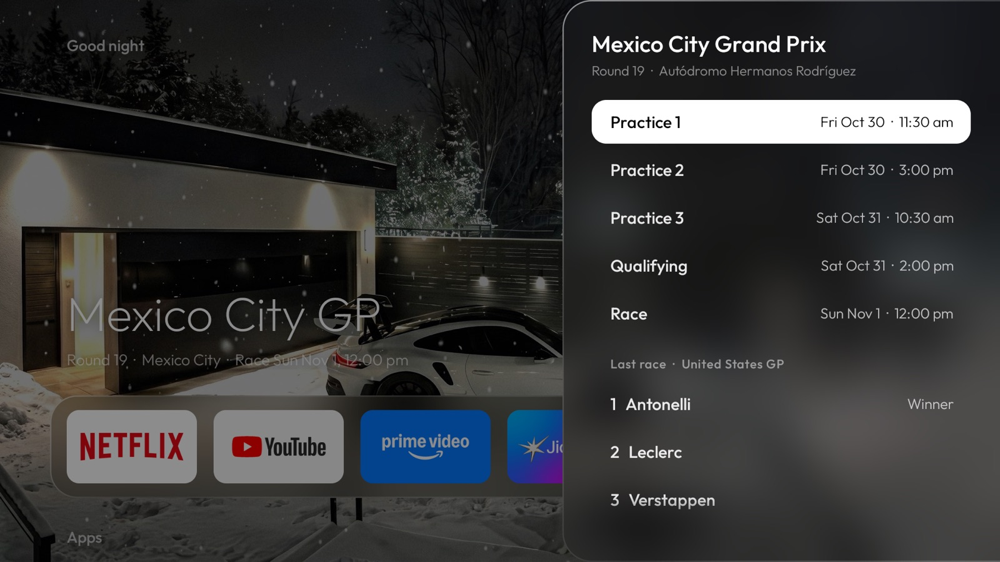</td>
  </tr>
  <tr>
    <td>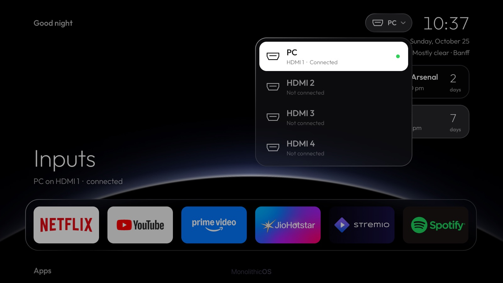</td>
    <td>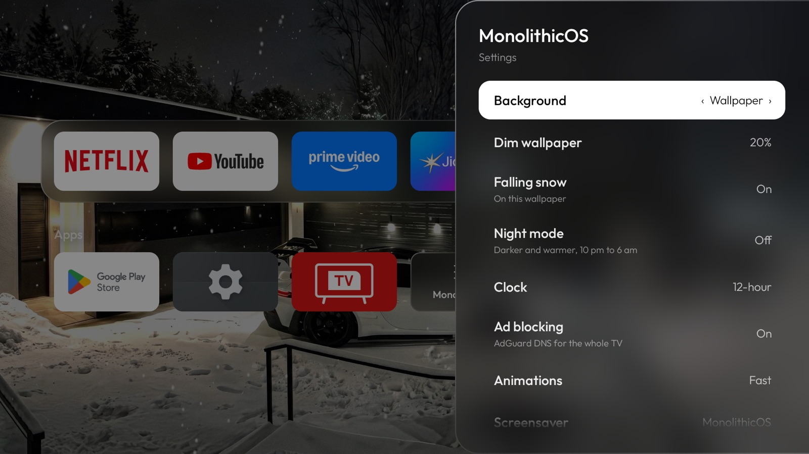</td>
  </tr>
</table>

  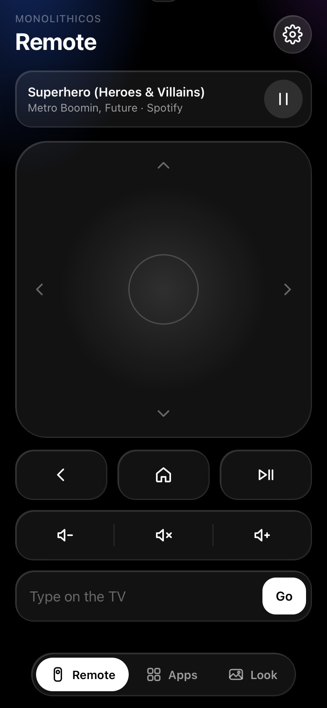
  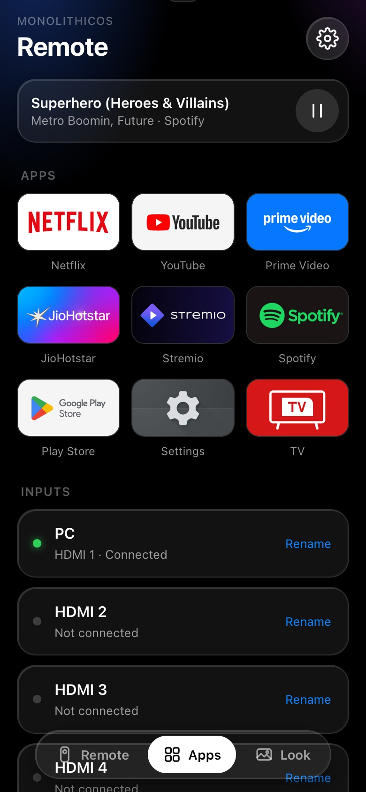
  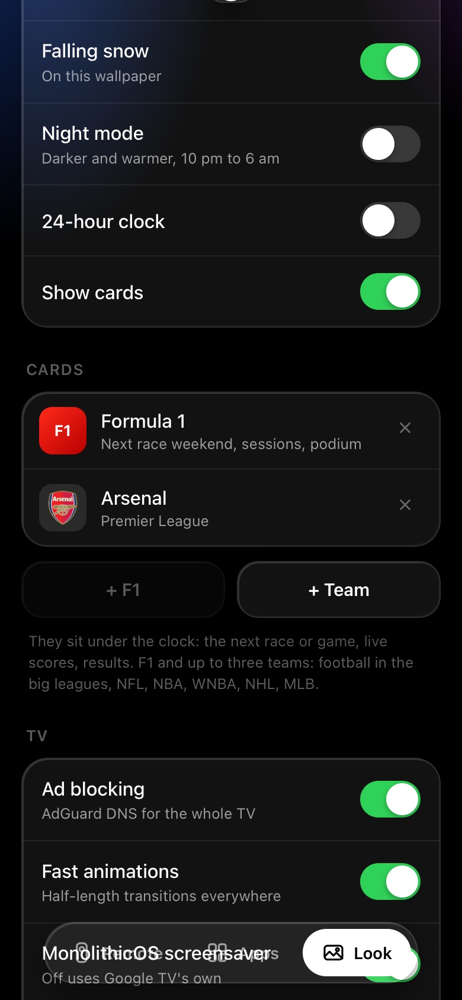
  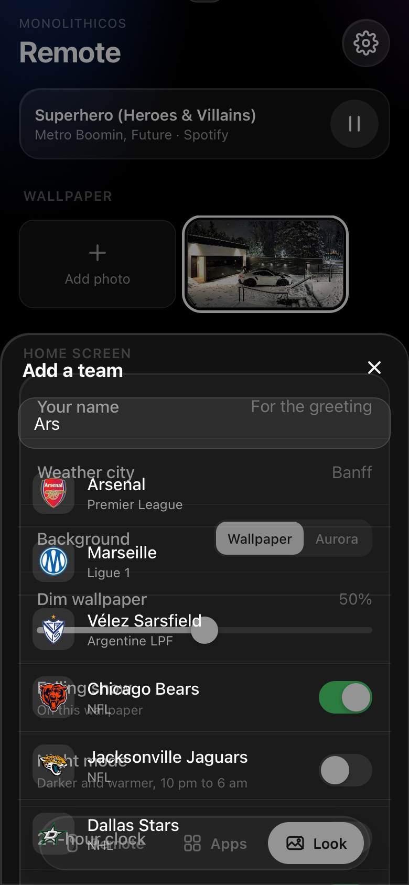

## Remote

| | |
|---|---|
| **OK** | Open the app |
| **Hold OK** | Move/add/remove dock apps, app info, settings |
| **Up** from the dock | Your cards, then Inputs |
| **Down** from the dock | All your apps |
| **Back / Home** | Back to the first app |

## Good to know

- Runs on Google TV and Android TV 9+ (Chromecast with Google TV, Sony, Hisense, TCL, Philips...). I built
  and tested it on my TCL QM851G (Google TV 14), so let me know how it goes on yours. Not Fire TV, Roku,
  Samsung or LG.
- With Google's home screen off, the remote's YouTube button and voice search for shows don't work.
  YouTube is in the dock; Netflix and Prime buttons work from the home screen.
- The weather effects can be turned off in MonolithicOS Settings or from your phone. For the right weather,
  give your city with its region if it shares a name (London, Ontario).
- If a TV update turns Google's stuff back on, you'll get a banner. Just run the installer again.
- It only talks to Open-Meteo (weather), ipapi.co (once, to guess your city), ESPN and Jolpica (cards, if you
  add any) and AdGuard DNS (if ad blocking is on).

## Uninstall

Double-click `Uninstall MonolithicOS`. Or on the TV: MonolithicOS Settings > TV Setup > Restore Google TV Home.

## Build it

JDK 17 and the Android SDK (34), no Gradle: `./tools/package.sh`

---

Made by Joe ([@ManjotSarna](https://github.com/ManjotSarna)), with a lot of help from Claude. MIT licensed.
Not affiliated with Apple, Google or TCL.
